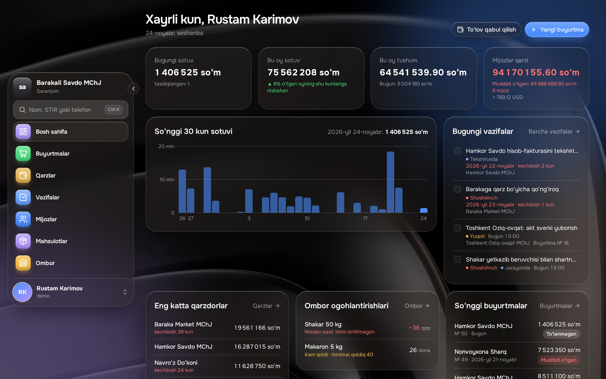
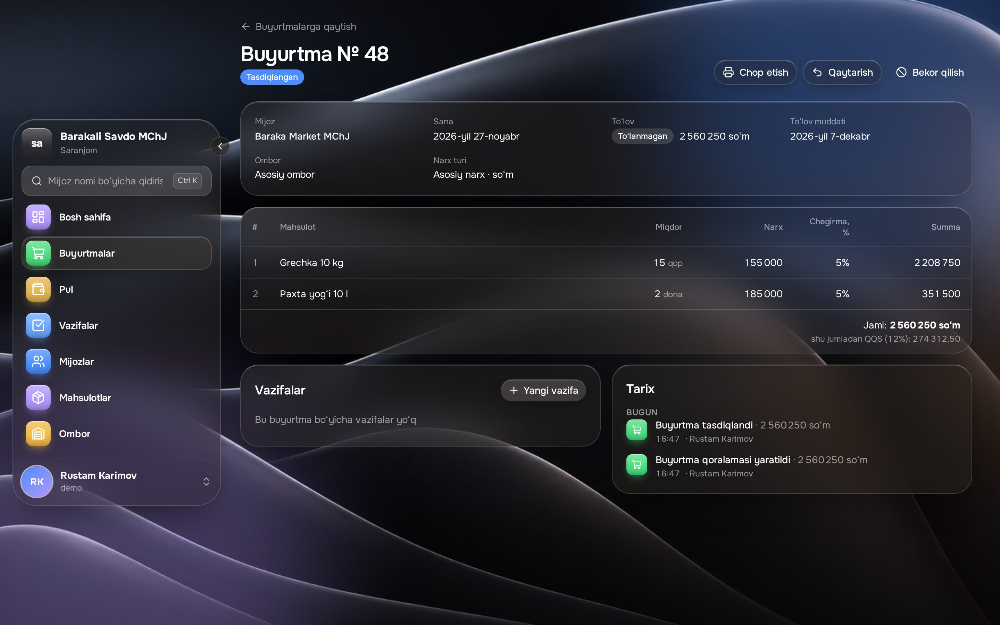
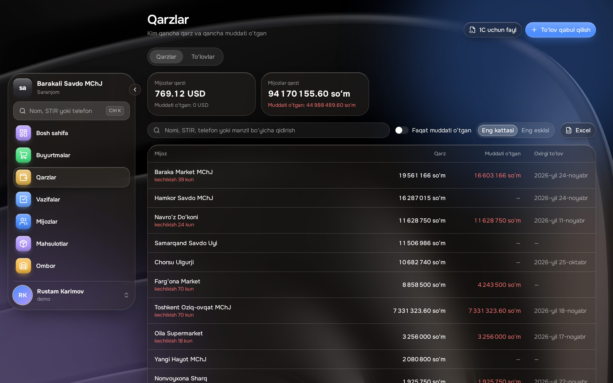
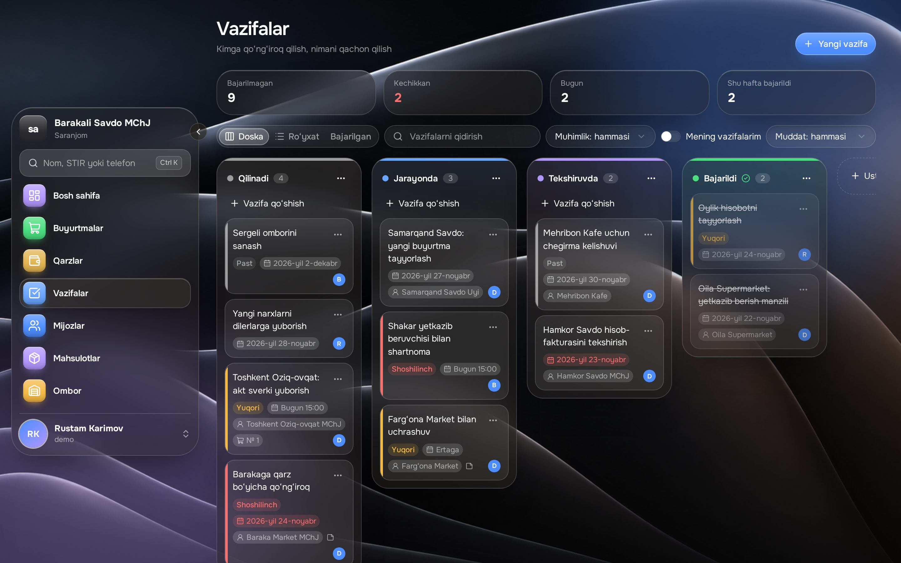
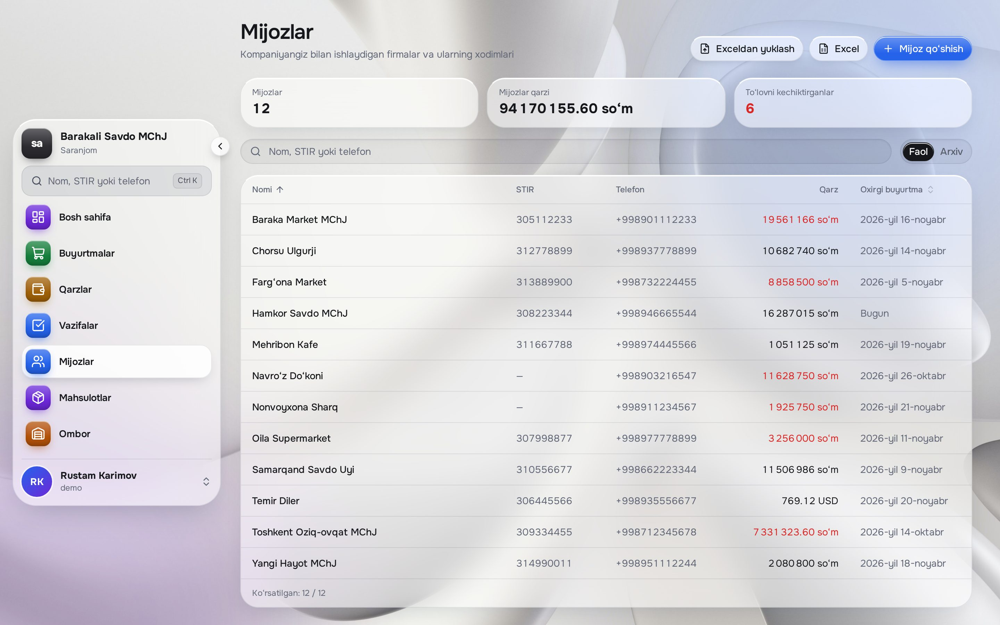
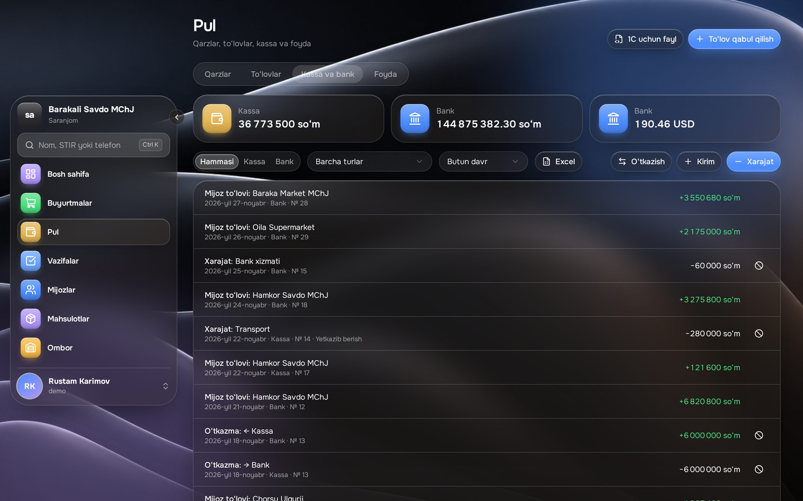
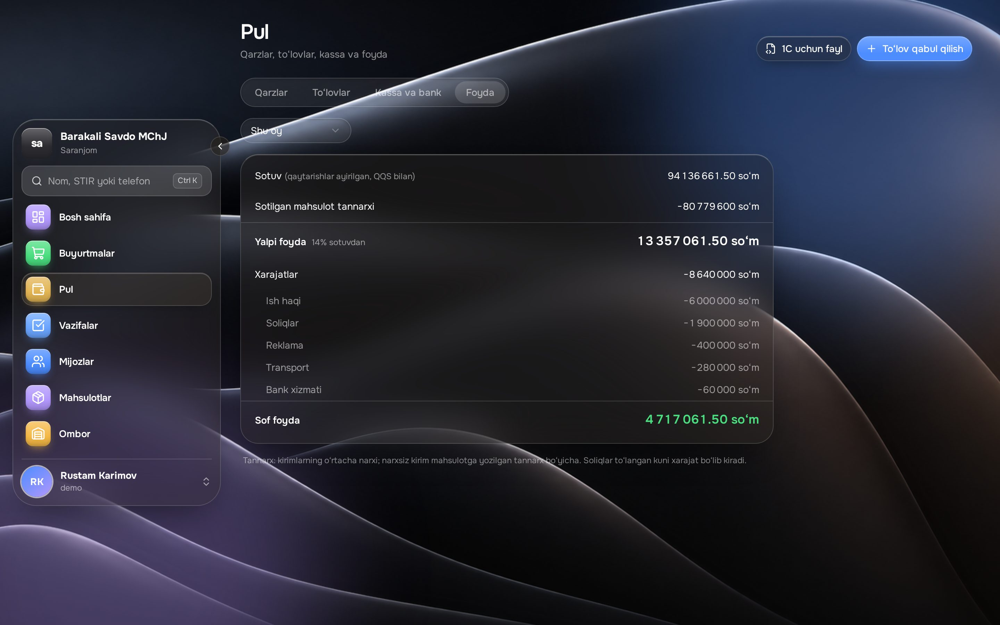
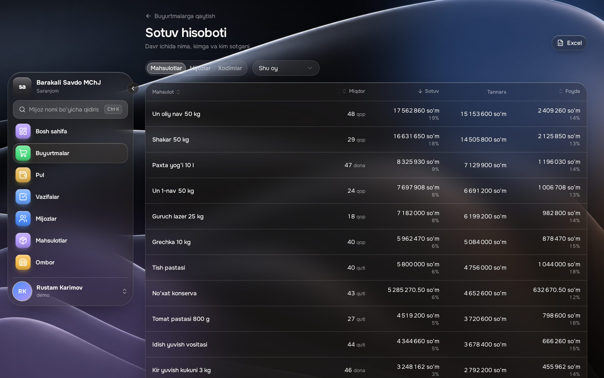
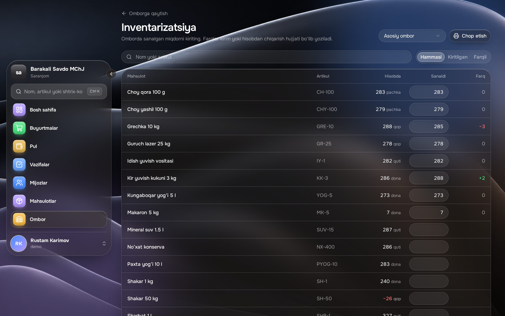

# Saranjom

An open-source sales, stock and money system for small wholesale and distribution companies in
Uzbekistan. *Saranjom* is Uzbek for "tidy, everything in its place".

It covers what a wholesaler does every day: selling, buying, stock, debts, the cash box and the
bank, and what was earned. Statutory accounting stays in 1C: a period's sales, returns and payments
go to the accountant as one file.

**Status:** early. The modules below work and are tested, but no company runs its business on it
yet. Expect changes.

**Try it:** [saranjom.uz](https://saranjom.uz). "Demoni koʻrish" on the login screen opens a demo
company to look around, no sign-up needed; signing up gives you your own empty company.



| | |
|---|---|
|  An order |  Debts |
|  Tasks |  Customers, in the light look |
|  Cash and bank |  Profit |
|  Sales report |  Stock count |

The screens show a made-up demo company.

## What it does

- **Customers:** search across Latin and Cyrillic spellings, duplicate warnings, contacts, notes and
  a timeline of every order, payment and task.
- **Products and prices:** categories, units, МХИК codes, several price lists in any currency, one
  per customer if needed.
- **Stock:** warehouses, receipts, write-offs and transfers as numbered documents, balances per
  warehouse, and a stock count that writes only the differences and prints as a count sheet.
- **Suppliers and purchases:** a receipt from a supplier is a purchase; what you owe each supplier
  and paying it.
- **Orders:** drafts, confirmation that takes stock, discounts, VAT by date, saved exchange rates,
  a printable invoice.
- **Payments and debts:** debts per customer and currency, overdue amounts, credit limits, opening
  debts, a printable akt sverki.
- **Returns:** part or all of an order, back into stock, with the debt lowered at the order's own
  prices.
- **Cash and bank:** what is in the cash box and the bank per currency, every movement of money in
  one list, expenses, and transfers between the two.
- **Profit:** a period's sales less what the sold goods cost less expenses. Cost is the average
  purchase price, or a cost typed on the product for goods that arrived without one.
- **Sales report:** a period's sales by product, by customer or by the person who entered the
  order, with cost, profit and margin.
- **Tasks:** a board with your own columns, priorities, due days, links to customers and orders.
- **Staff and roles:** each company defines its roles and what each one sees and changes; every
  route is checked on the server.
- **Excel import:** customers (with opening debts) and products (with prices, cost and stock) from
  a firm's own file or a 1C list, with a preview of what will change.
- **1C export:** an EnterpriseData file (1.4, 1.5 or 1.8) that «1С:Бухгалтерия» loads.
- **Overview:** a dashboard, a history of every change, sortable and filterable lists, Excel files.

The interface is in Uzbek (Latin and Cyrillic) and Russian, with glass and plain looks, light and
dark.

## Built with

- **Backend:** Python 3.12, FastAPI, SQLAlchemy (async), PostgreSQL 17 with row-level security per
  company, Alembic.
- **Frontend:** React, Vite, TypeScript, Tailwind, shadcn/ui, TanStack Router and Query.
- **Tests:** API tests against a real database, Vitest, and Playwright end-to-end flows, all in CI.

## Run it locally

You need Docker, Python 3.12 with [Poetry](https://python-poetry.org/), and Node 22.

```bash
docker compose up -d         # PostgreSQL
cp .env.template .env        # already matches that database
poetry install --no-root
cd app && poetry run make migrate && poetry run make run    # the API, on port 8000
```

In a second terminal:

```bash
cd frontend && npm install && npm run dev
```

Open the address Vite prints and sign up a company. For a company with two months of sample
activity instead, run this from the repo root and log in with the name and password in the script's
first lines:

```bash
poetry run python -m app.scripts.seed_demo
```

## Tests

```bash
scripts/test.sh                 # backend, on its own fresh database
cd frontend && npm test         # frontend logic
scripts/e2e.sh                  # the built app in a real browser
```

## Run it on a server

One small server is enough: Docker runs PostgreSQL, the API and Caddy, which gets the HTTPS
certificate by itself. Point your domain at the server, then from your own machine:

```bash
ssh <server> 'bash -s -- erp.example.uz' < scripts/server-setup.sh   # once, as root
scripts/deploy.sh <server>                                            # every release
```

The first script installs Docker, a firewall, automatic security updates and a nightly database
backup, and generates the passwords on the server. Read both scripts before running them; they are
short.

## License

[AGPL-3.0](LICENSE). You may use, change and host it; if you offer a changed version to others over
a network, you must share your changes under the same license.
